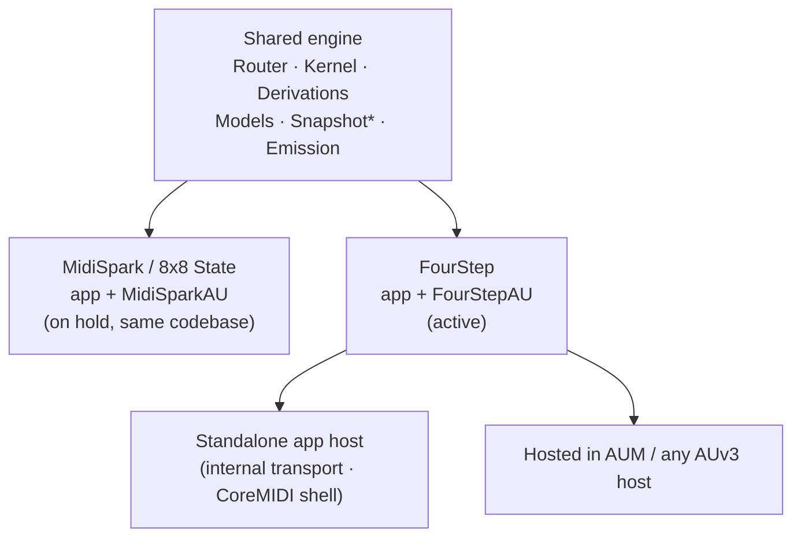

# What is FourStep?

> Four lanes. One chord. Whatever rhythm you draw.

FourStep is Euclideous, released on its own: a four-lane Euclidean-rhythm MIDI processor that
turns a single held chord into four independently-walking rhythmic voices — standalone AUv3,
standalone app, no 8×8 grid required.

## The four lanes

Each lane is a Euclidean hit pattern (K pulses over N steps, rotated, tilted early/late) that
can either strike notes from the held chord directly, or walk a shared riff — a stencil of
*ranks*, not pitches, so the same walked line replays correctly against any chord you hold.
Lanes can mask each other's hits (mute, repeat, ratchet, invert, chord-stab, octave-shift) and
each resolves its own independent restart point against a shared step sequencer.

Every lane carries the same four facets — what differs is what each is currently pointed at:

- **Rhythm** — the pattern itself: K-of-N Euclidean hits, rotated and tilted early/late, with
  its own direction (forward / backward / ping-pong) and its own restart point.
- **Riff** — a walked stencil of ranks: six walk directions over one shared 8-step rank matrix,
  four independently stored — lock to a fixed restart, invert, tie over a rest, capture a played
  line as ranks against the held chord.
- **Notes** — an additive lit layer: up to eight ranks plus top/top-2, each with its own octave
  shift, sounding *alongside* the riff, not instead of it.
- **Mask** — a pattern over the pattern: a second K-of-N shape gating the lane's own hits (mute,
  pause, ratchet, repeat, a chord stab, an octave or velocity shift — eleven modes, gated by
  chance).

## Vocabulary

Deliberately not the wider 8×8 State vocabulary — FourStep has no receiver/door graph, no cables
beyond a flat A–D toggle, no chain of twenty processor types. This is the whole glossary:

- **Lane** — one of four independent voices, each with its own rhythm, riff position, lit notes,
  and mask.
- **Riff** — a stencil of ranks over an 8-step grid, shared across whichever lanes are currently
  walking it; four stored, one edited at a time.
- **Riff capture** — "play a line in": latch a chord, play a line, FourStep records it as ranks
  against that chord so it replays correctly against any later chord.
- **Mask** — a per-lane modifier pattern; not the same thing as the separate, standalone Euclid
  Mask processor that lives elsewhere in the shared engine.
- **Sequencer panel** — the two-tab step grid (LANES / RIFFS) controlling which lane sounds, and
  which riff plays, at each step of its own independent sequence.
- **Main out A–D** — a flat per-lane output toggle; four destinations, no bus/cable/channel-stamp
  model behind it.

## Still a reactive, chord-following instrument

Nothing stores pitch. A riff is a stencil of ranks; the four lanes are a stencil of rhythms.
Hold any chord, in any key, and the same four lanes re-derive against it — change the chord and
the pattern follows, without re-programming anything. The generation is deterministic (a pure
function of host beat position + held chord), so a passage is replay-exact.

## v1 scope

**In**: the four lanes (rhythm/riff/notes/mask), the shared riff grid + riff capture ("play a
line in"), the LANES/RIFFS sequencer panel, MIDI IN / CHORDS / KEY as the note source, MAIN OUT
A–D, undo/redo, the 20 factory presets, standalone AUv3 + standalone app hosting it.

**Out (this is the whole rest of 8×8 State, explicitly not part of FourStep)**: the 8×8 grid
itself, rooms/play-ferries, the processor chain/rack (arp/strum/chance/harmonize/the 20+ other
processor types), macro automation, the scene strip, the receiver-door routing graph, presets
for the wider plugin. None of this is "coming later to FourStep" by default — if any of it is
ever wanted there, that's a new decision, not an assumed extraction.

## Relationship to MidiSpark / 8×8 State

One codebase, two shipped products sharing one engine. See CLAUDE.md's "Scope" section for the
product/doc split, and `Docs/standalone-plan.md` for the target architecture.

The reserved engine row Euclideous composes into (`Snap.euclideousRow`) runs through the identical
render pipeline as any other row — no special-cased path, no second way to drive the engine.

## Companion references

- `Docs/claude-playbook.md` — how to work effectively with Claude on this codebase.
- `Docs/fourstep-design-tokens.md` — the actual shipped palette, lane accents, spacing scale, and
  component patterns, each tagged by how it was sourced.
- Browsable versions of all three live as published artifacts — see the links inside each file.
